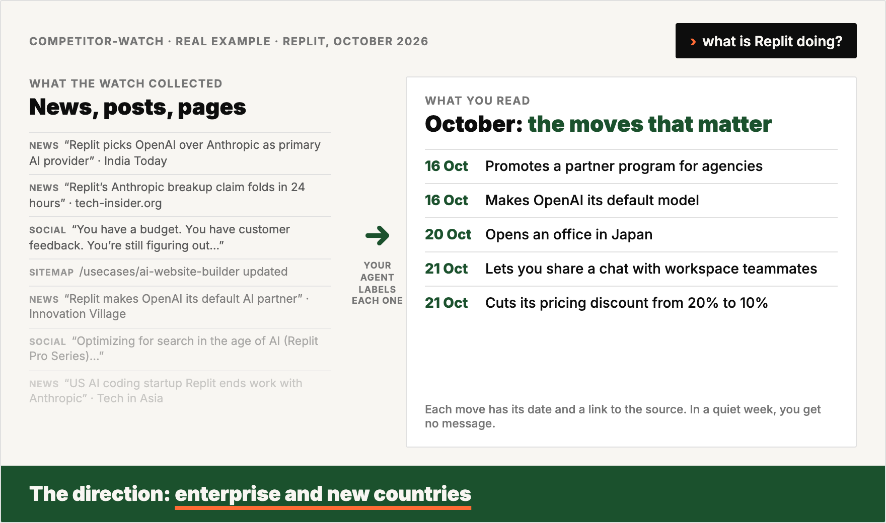
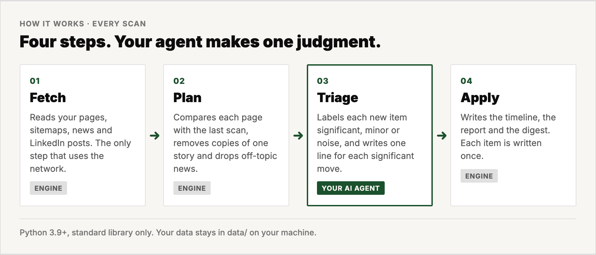
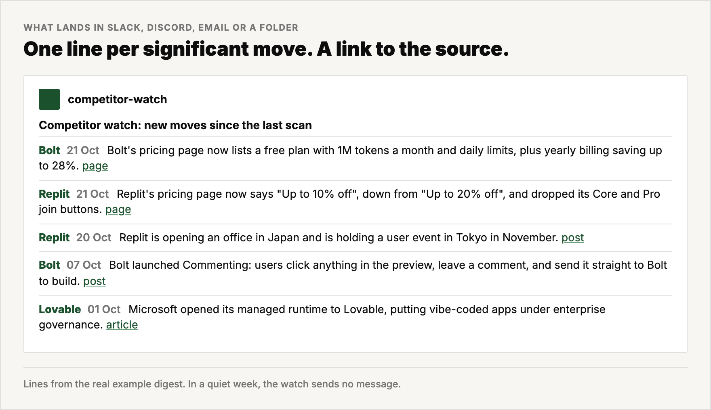

<h1 align="center">competitor-watch</h1>

<p align="center">
  <strong>See every competitor move the week it happens. Read only the moves that matter.</strong>
</p>

<p align="center">
  A weekly competitor watch for marketers and founders. Your AI agent installs it from one message and runs it for you.
</p>

<p align="center">
  
  
  
  
</p>

<p align="center">
  
</p>

A snapshot shows where a competitor is. A timeline shows which way it moves.

competitor-watch records each competitor's moves with their dates. It watches four sources: the pages you choose, new pages in the sitemap, news, and LinkedIn posts from the company and its founders. After each scan, your AI agent sends you only the significant moves, one line each, with a link to the source. In a quiet week, the watch sends no message.

> **AI agents:** read [`AGENTS.md`](AGENTS.md). It is the complete protocol.

https://github.com/user-attachments/assets/3c6a2141-859a-4e47-ba2b-461e11d81e1d

## Before and after

| Without the watch | With the watch |
|---|---|
| You check each competitor's site by hand, now and then. | Each scan compares the pages you choose with the last scan. |
| A news search for the name returns chapel events and football scores. | The tool removes off-topic news before your agent reads it. |
| Ten outlets print one story, and you read it ten times. | The tool keeps one copy of each story. |
| You see where a competitor is today. | You see a dated timeline and the direction it shows. |
| A broken source looks like a quiet week. | The report names each failed source and the reason. |

The example in this repo is a real run on four AI app builders: Lovable, Bolt, Base44 and Replit. Ask your agent *"what is Replit doing?"* and it reads the timeline. In October, Replit announced an office in Japan, promoted a partner program for agencies, made OpenAI its default model and cut its discount in half. Each move alone is news. Together, the moves show a push into enterprise and new countries.

## How it works

<p align="center">
  
</p>

| Source | What the watch reads |
|---|---|
| **Website pages** | Pricing, homepage or changelog pages you choose. Setup compares each with a capture from three months ago. |
| **Sitemap** | New and removed pages, often the first sign of a new product, a new segment or a retreat. |
| **News** | Google News and Tavily news search. The tool removes off-topic results before your agent reads them. |
| **LinkedIn** | Posts from the company page and from up to two people per competitor, such as the founder. |

Plain Python 3.9+, standard library only: nothing to install. Your data stays in `data/` on your machine, and git ignores it.

## The output

<p align="center">
  
</p>

- **A timeline per competitor** in `data/competitors/<name>.md`, plus JSON for your agent. Each event has the date when it happened.
- **A digest** after each scan with only the significant moves. It lands in Slack, Discord, email or a folder.
- **A report** per scan with the detail and the health of every source.
- **Answers on demand.** Ask your agent *"what has Bolt been doing since summer?"* and it reads the timeline.

## Who it is for

| Built for | Not built for |
|---|---|
| Marketers who watch 3 to 8 competitors | Alerts within minutes. The watch scans on a schedule, weekly by default. |
| Founders who do their own marketing | Ads, reviews, job posts or X. The watch reads four sources only. |
| Anyone with an AI agent that works in a folder | Pages that only JavaScript renders. Setup swaps them for a changelog, docs or blog page. |

## Install with one message

Open your project in your AI agent and send:

```
Install https://github.com/4arkin/competitor-watch, read its AGENTS.md,
and set up a competitor watch for this project.
```

Your agent then:

1. Reads your project and proposes competitors, pages and people. You approve the list in about 2 minutes.
2. Asks for two free API keys and checks that everything works.
3. Pulls the last 90 days and shows you a timeline for each competitor.
4. Asks how often to scan and where to send the digest.
5. Schedules the watch and tests the schedule once.

Setup takes about 15 minutes, most of it for the 90-day backfill.

## Works with

| Agent | Setup | Unattended runs |
|---|---|---|
| **Claude Code** (CLI or desktop) | Reads `CLAUDE.md` → `AGENTS.md` | Desktop app scheduled task, or launchd/cron with `claude -p` |
| **Codex CLI** | Reads `AGENTS.md` | cron with `codex exec` |
| **Gemini CLI** | Reads `GEMINI.md` → `AGENTS.md` | cron with `gemini -p` |

## Cost

| Service | Used for | Free plan | Typical use (5 competitors, weekly) |
|---|---|---|---|
| [Apify](https://apify.com) | LinkedIn posts | $5/month | about $1/month at most. About $0.60 once for the backfill |
| [Tavily](https://tavily.com) | News search, blocked pages | 1,000 credits/month | about 30 credits/month |
| Google News, Wayback Machine | News, page history | free, no key | — |

`bin/cw doctor` prints the estimate for your own roster before anything is spent. Prices checked October 2026.

## FAQ

**Do I need to write code?**
No. You send one message. Your agent clones the repo, writes the config, asks you for two free keys and runs the first scan.

**What does it cost?**
A weekly watch on five competitors stays inside the free tiers. `bin/cw doctor` prints the estimate for your roster before anything is spent.

**Will the digest fill with noise?**
The tool removes off-topic news before your agent reads it, and it keeps one copy of each story. Only significant moves reach the digest.

**What if a source fails?**
The report names the source and the reason. If every source fails, the run exits with an error. A failure never looks like a quiet week.

**Where does my data go?**
It stays in `data/` on your machine. The only outbound calls go to the sites you watch, Google News, the Wayback Machine, Apify and Tavily.

## Inside

| Path | What |
|---|---|
| [`AGENTS.md`](AGENTS.md) | The protocol your agent follows: setup, every cycle, reading the timeline |
| [`prompts/`](prompts/) | The setup interview, the triage rules, how to read a timeline |
| [`schedule/`](schedule/) | cron, launchd, desktop-app and webhook recipes |
| [`GOTCHAS.md`](GOTCHAS.md) | Known traps, and the fix for each |
| `bin/cw`, `cw/` | The engine |
| [`examples/`](examples/) | A real run on four AI app builders |
| `tests/` | `python3 -m unittest discover -s tests`, offline |

## License

MIT. See [`LICENSE`](LICENSE).
